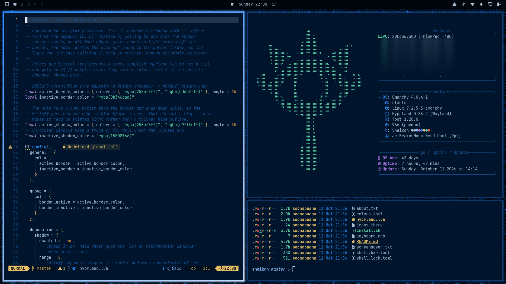

# Sheikah

An Omarchy theme based on the aesthetic of the Sheikah Slate from *The Legend of Zelda: Breath of
the Wild*.



Theme colors are sampled from `backgrounds/01-1258416.jpg`, the Sheikah tapestry.

```
background  #00152d      accent/blue  #258af5      cyan     #8fc3ff
foreground  #afc1d5      orange       #ff9e45      red      #ff5c48
```

Focused windows carry a border gradient and a matching halo, at the same 45°
sweep, so the light stays in register with the edge emitting it.

## Install

```bash
omarchy theme install https://github.com/yeshwanth95/omarchy-sheikah-theme.git
```

Then select it from **Omarchy menu → Style → Theme**. That gets you the
palette, the backgrounds and the terminal/editor colors.

### Then optionally run this for enabling the glowing window borders and Sheikah screensaver and branding:

```bash
cd ~/.config/omarchy/themes/sheikah
./install.sh
```

Two parts of the theme cannot switch themselves on, because Omarchy
deliberately will not let a theme installed from a git repo supply them:

- **The border glow.** It needs `hyprland.lua`, and `omarchy-theme-set` strips
  `*.lua` from any theme that arrived as a git clone — Lua is executable code
  running in your Hyprland session, so a stranger's repo does not get to ship
  it. Without this step the borders still get their gradient, but no halo.
- **The screensaver and about art.** `omarchy-screensaver` and
  `omarchy-branding-about` read fixed paths under `~/.config/omarchy/branding/`
  and never consult the active theme, so shipping the art is not enough to
  apply it.

`install.sh` will enable both of these. Everything it changes is inside your home directory — no `sudo`, nothing under `/usr`:

| path | what it is |
|---|---|
| `~/.config/omarchy/hooks/theme-set.d/omarchy-theme-extras` | a `theme-set` hook |
| `~/.config/omarchy/theme-extras.allow` | adds `sheikah` to the Lua allowlist |

The hook runs on every theme change from then on. It is theme-agnostic: it
leaves themes that ship none of these files alone, and when you switch to a
theme with no ASCII art it restores Omarchy's own rather than stranding the
Sheikah eye.

To undo it:

```bash
./install.sh --uninstall
```

## About that allowlist

Re-enabling Lua re-opens a hole Omarchy closed on purpose, so the hook only
does it for themes named in `~/.config/omarchy/theme-extras.allow`, one per
line. Running `install.sh` is the act of vouching for this theme. Every other
installed theme stays denied exactly as Omarchy intended — installing a second
themed repo does not get its Lua executed just because this hook exists.

If you would rather read before you trust, `hyprland.lua` is the whole of it:
two border colors, two halo colors, and a `decoration.shadow` block. You can simply implement this manually in your copy of the theme if you're not comfortable running scripts.

## How the glow works

Hyprland has no glow primitive. This is `decoration:shadow` with its offset
left at the default `[0, 0]`: instead of falling to one side the shadow spreads
evenly on all four edges, which reads as light coming off the border. The halo
runs a rung hotter than the border and ends near white, so the falloff goes
charged edge → blue bloom → navy. That chromatic step is what makes it read as
emitted light rather than a thicker blue outline.

`range` is held at 8, under Omarchy's default `gaps_out` of 10, so neighbouring
windows' halos never touch.

## What's in here

```
colors.toml        the palette — single source of truth for everything generated
hyprland.lua       border gradient + halo (needs install.sh on a cloned install)
screensaver.txt    the Sheikah eye, in braille
about.txt          the same, for the about window
shell.bar.toml     the bar, as the Slate's bezel
shell.lock.toml    the lock screen
icons.theme        Yaru-prussiangreen-dark
keyboard.rgb       258af5
backgrounds/       01-1258416.jpg is the tapestry everything is sampled from
generator/         draws procedural Sheikah wallpapers — see generator/README.md
install.sh         the optional post-install step above
```

`alacritty.toml`, `foot.ini`, `neovim.lua` and `vscode.json` are intentionally
absent: Omarchy generates them from `colors.toml` via its own templates, so
shipping them would only let them drift from the palette.

## Changing the palette

Edit `colors.toml` and re-apply the theme. Two caveats:

- `hyprland.lua` repeats its colors as literal hex, because a theme-supplied
  `.lua` is not a `.tpl` and gets no `{{ }}` substitution. Change both.
- `shell.bar.toml` and `shell.lock.toml` fully replace their sections and are
  applied after templating, so they take literal hex too.

`cyan` is kept a visibly paler rung than `blue` on purpose. `dircolors` paints
directories `01;34` and symlinks `01;36`, and neither foot nor alacritty maps
bold to bright — if those two collapse, `ls` stops distinguishing a symlink
from a directory.
