# Sheikah

An Omarchy theme based on the aesthetic of the Sheikah Slate from *The Legend of Zelda: Breath of
the Wild*.

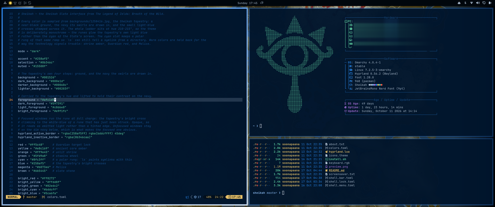
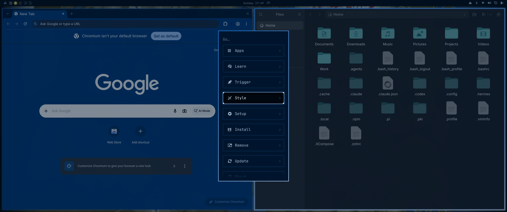
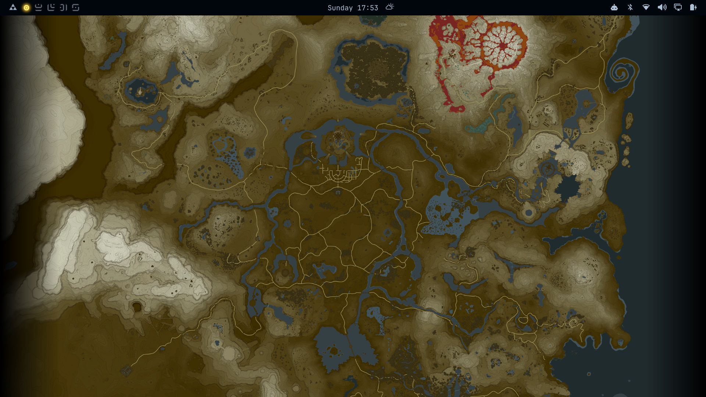
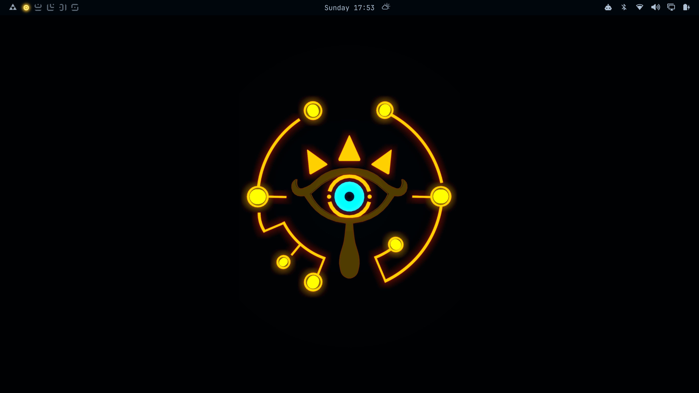


Every colour is sampled from `backgrounds/01-1258416.jpg`, the Sheikah tapestry.

```
background  #00152d      accent/blue  #258af5      cyan     #8fc3ff
foreground  #afc1d5      orange       #ff9e45      red      #ff5c48
```

## Features

### Base — nothing to run

Installing the theme gets you all of this:

- The palette across terminals, editors, `btop` and everything else Omarchy
  themes from a colour file.
- **Focused window borders** with a 45° gradient.
- **The menu's selected row** sunk to the tapestry's ground colour with a
  bright edge around it.
- **The bar and the lock screen** in the Slate's bezel colours, with the lock's
  rune border charging as you type and dropping to Guardian red on a failure.
- **Ten wallpapers** — `omarchy theme bg next` cycles them.
- Yaru-prussiangreen-dark icons and a `#258af5` keyboard.

### Extras — `./install.sh`

Three things Omarchy deliberately will not let a theme installed from a git
repo switch on by itself:

- **The halo around focused windows.** Light coming off the border, a rung
  hotter than the border itself. Needs `hyprland.lua`, and Omarchy strips
  `*.lua` from any theme that arrived as a git clone.
- **The Sheikah eye** as the screensaver and the about-window art.
- **The workspace quest marker**, plus the **workspace numbers in Sheikah
  numerals**. Ships as a stand-in bar widget, because the `omarchy.*` plugin
  namespace is reserved.

All of it is theme-conditional: switch to another theme and you get that
theme's look back, with no further action.

### The lock screen — `./install.sh --with-lock`

Opt-in on its own flag, because unlike everything else here a broken lock
screen keeps you out of your own machine.

- **The Slate's bezel** drawn over the blurred wallpaper.
- **A fade** in on lock and out on unlock. Hyprland animates neither.
- **Runes instead of bullets** in the passphrase field, from the font the theme
  ships. Falls back to the stock bullet if the font does not load.

### The menu — a manual edit

The menu belongs to whichever plugin owns it, so an installer has no business
rewriting your `shell.json`. These are yours to patch into your own menu
plugin; the full notes are in the files below.

- **The active row's frame** — corner brackets and a halo. *(The fill and the
  bright edge are in the base theme and need no patch.)*
- **Grow and shrink** from the card's own centre when the menu opens and
  closes.
- **The triforce** in place of the Omarchy mark on the menu button.

## Backgrounds

`01` is the tapestry every colour in the theme is sampled from. The rest range
wider than the palette does, from near-black slate to the warm reds of the
Ancient murals, on the grounds that a wallpaper is allowed to be a picture
rather than a swatch. Click any for the full-resolution file.

<table>
  <tr>
    <td><a href="backgrounds/01-1258416.jpg">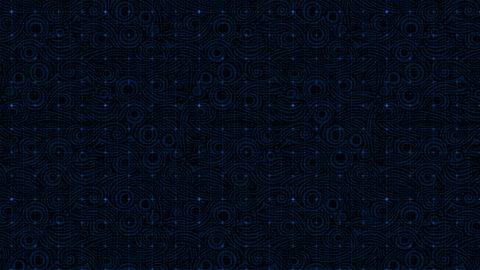</a></td>
    <td><a href="backgrounds/02-wallhaven-p8rgpj_3840x2160.png">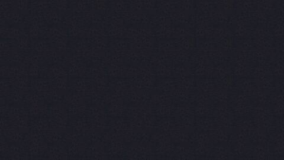</a></td>
    <td><a href="backgrounds/03-wallhaven-1qrlwv.jpg">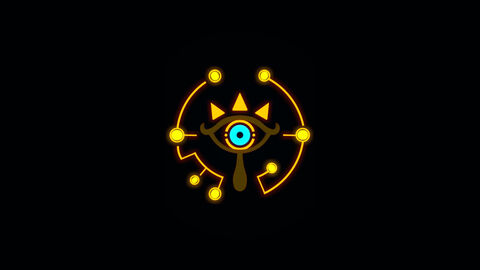</a></td>
  </tr>
  <tr>
    <td align="center"><sub><b>01</b> &middot; the tapestry &mdash; palette source</sub></td>
    <td align="center"><sub><b>02</b></sub></td>
    <td align="center"><sub><b>03</b></sub></td>
  </tr>
  <tr>
    <td><a href="backgrounds/04-1025644.png">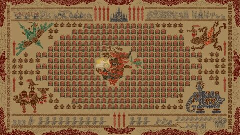</a></td>
    <td><a href="backgrounds/05-wallhaven-gp29gl.jpg">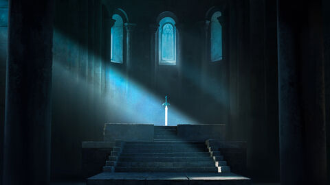</a></td>
    <td><a href="backgrounds/06-wallhaven-dp6kdl.jpg">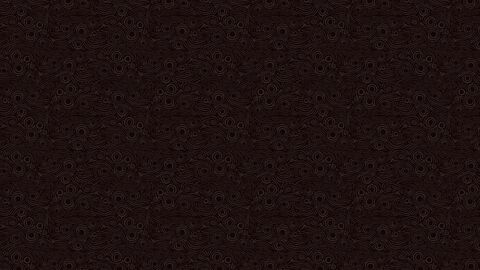</a></td>
  </tr>
  <tr>
    <td align="center"><sub><b>04</b></sub></td>
    <td align="center"><sub><b>05</b></sub></td>
    <td align="center"><sub><b>06</b></sub></td>
  </tr>
  <tr>
    <td><a href="backgrounds/10-wallhaven-k8dyqq.png">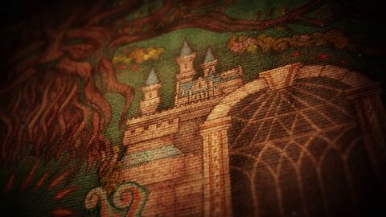</a></td>
    <td><a href="backgrounds/11-wallhaven-qro7yq.png">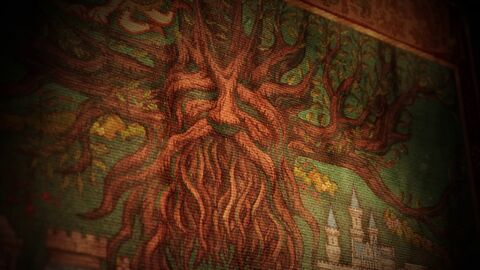</a></td>
    <td><a href="backgrounds/13-wallhaven-zp9kej.png">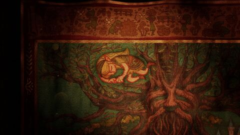</a></td>
  </tr>
  <tr>
    <td align="center"><sub><b>10</b></sub></td>
    <td align="center"><sub><b>11</b></sub></td>
    <td align="center"><sub><b>13</b></sub></td>
  </tr>
  <tr>
    <td><a href="backgrounds/botw_map_x2160.png">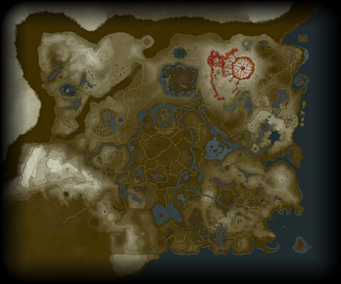</a></td>
    <td></td>
    <td></td>
  </tr>
  <tr>
    <td align="center"><sub><b>botw_map</b></sub></td>
    <td></td>
    <td></td>
  </tr>
</table>

## Install

```bash
omarchy theme install https://github.com/yeshwanth95/omarchy-sheikah-theme.git
```

Then pick it from **Omarchy menu → Style → Theme**. That is the base theme, done.

For the extras:

```bash
cd ~/.config/omarchy/themes/sheikah
./install.sh                 # halo, branding art, workspace widget
./install.sh --with-lock     # the above, plus the lock screen
```

Everything it touches is inside your home directory — no `sudo`, nothing under
`/usr`:

| path | what it is |
|---|---|
| `~/.config/omarchy/hooks/theme-set.d/sheikah-theme-extras` | a `theme-set` hook, run on every theme change from then on |
| `~/.config/omarchy/theme-extras.allow` | adds `sheikah` to the Lua allowlist |
| `~/.config/omarchy/plugins/sheikah.workspaces/` | the workspace bar widget |
| `~/.config/omarchy/plugins/sheikah.lock/` | the lock screen, `--with-lock` only |

The allowlist is per theme and running `install.sh` is the act of vouching for
this one. Every other installed theme stays denied exactly as Omarchy intended.
`hyprland.lua` is the whole of what it unlocks: two border colours, two halo
colours and a shadow block — readable in a minute, and applicable by hand if
you would rather not run the script.

With `--with-lock`, restart the shell and check it before you trust it:

```bash
omarchy restart shell
omarchy-shell lock preview     # SAFE: renders the real view, takes no session
                               # lock. Click anywhere to dismiss.
```

If a lock ever does go wrong, `omarchy restart shell` from a TTY
(`Ctrl+Alt+F2`) recovers a stuck one, and `./install.sh --uninstall` puts the
stock lock screen back.

## Uninstall

```bash
cd ~/.config/omarchy/themes/sheikah
./install.sh --uninstall
```

Removes the hook, de-allowlists the theme, and restores the built-in workspaces
widget and lock screen. The branding art is left alone; Omarchy's own comes back
with:

```bash
omarchy branding screensaver reset && omarchy branding about reset
```

To remove the theme itself: `omarchy theme remove sheikah`.

## How it works

There is no separate design document — every feature is commented where it
lives:

| file | what it covers |
|---|---|
| `colors.toml` | the palette, and what to change with it |
| `hyprland.lua` | the border gradient and the halo |
| `shell.bar.toml` | the bar, and the workspace numerals |
| `shell.lock.toml` | the lock screen's colours, frame, fade and rune mask |
| `shell.menu.toml` | the menu, the active row, the open animation, and how to patch your menu plugin |
| `install.sh` | what the installer does, and why each edit is gated on its own |
| `install/lock-frame/*.qml` | the lock screen patch itself |
| `install/plugins/sheikah.workspaces/BarWidget.qml` | the quest marker and the numerals |
| `assets/triforce.svg` | how to put the triforce on the menu button |
| `assets/sheikah_frame_art.svg` | how to rebuild the baked lock frame |

